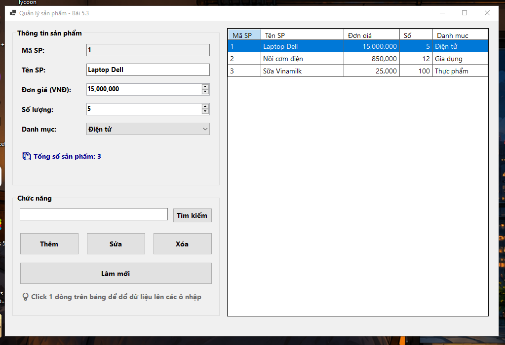
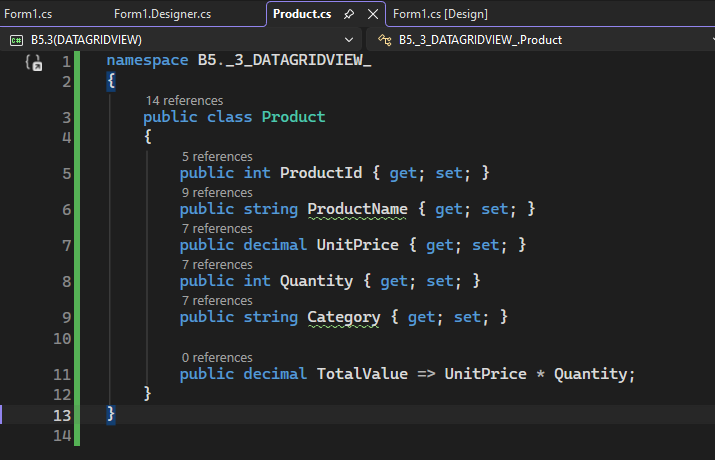
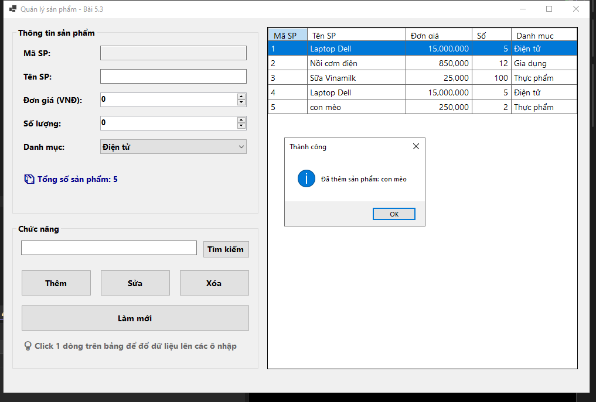
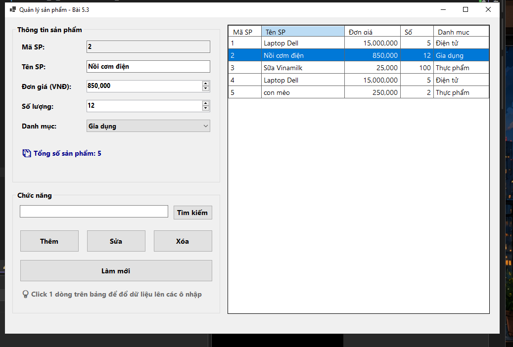
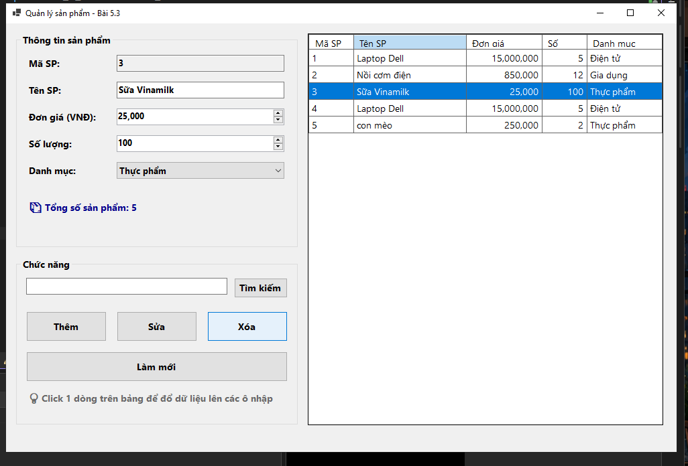
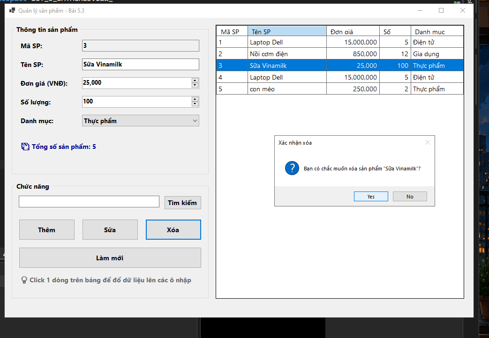
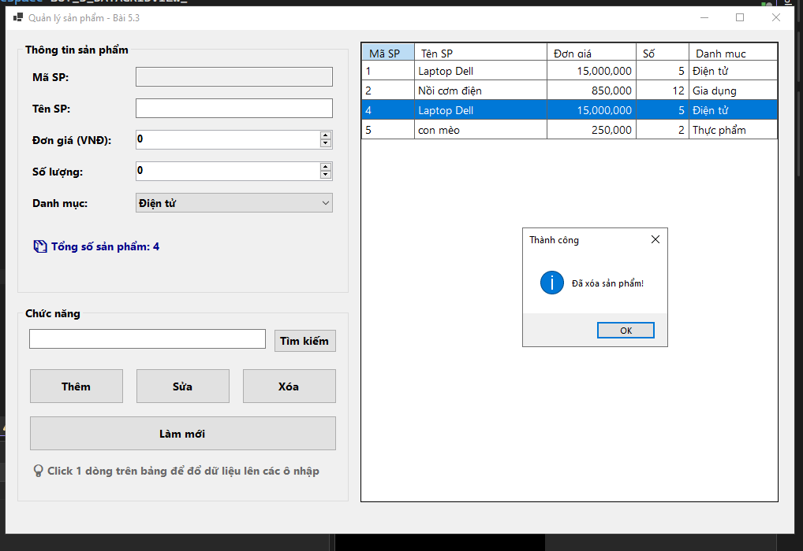

# BÁO CÁO BÀI TẬP

## THÔNG TIN SINH VIÊN
- **Họ và tên: Đặng Cao Thành Đạt**
- **Mã số sinh viên: 24810320215** 
- **Lớp: D19QTANM1** 
- **Tên môn học: Lập Trình.Net** 
- **Tên bài tập: BÀI 5.3: FORM QUẢN LÝ DANH SÁCH SẢN PHẨM TRONG BỘ NHỚ
(DATAGRIDVIEW CƠ BẢN)** 

---

## KẾT QUẢ THỰC HÀNH

### 1. Ảnh màn hình Giao diện chính

### 2. Khởi tạo một lớp Product gồm các thuộc tính: ProductId, ProductName, UnitPrice, Quantity, Category.

### 3. Nút Thêm: Khởi tạo đối tượng Product từ các ô nhập liệu, thêm vào List<Product> và làm mới giao diện DataGridView.

### 3. Khi Click vào một dòng trong DataGridView, đẩy ngược dữ liệu dòng đó lên các ô nhập liệu tương ứng.

### 3.1 Nút Xóa: Xóa đối tượng đang được chọn ra khỏi danh sách sau khi người dùng xác nhận qua MessageBox.

### 3.2 Nút Xóa: Xóa đối tượng đang được chọn ra khỏi danh sách sau khi người dùng xác nhận qua MessageBox.

### 3.3 Nút Xóa: Xóa đối tượng đang được chọn ra khỏi danh sách sau khi người dùng xác nhận qua MessageBox.
